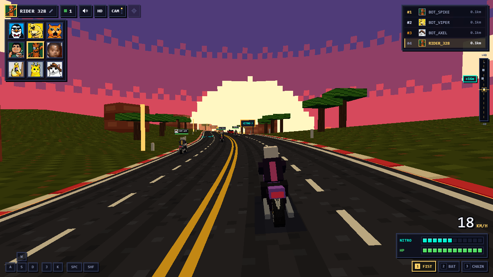
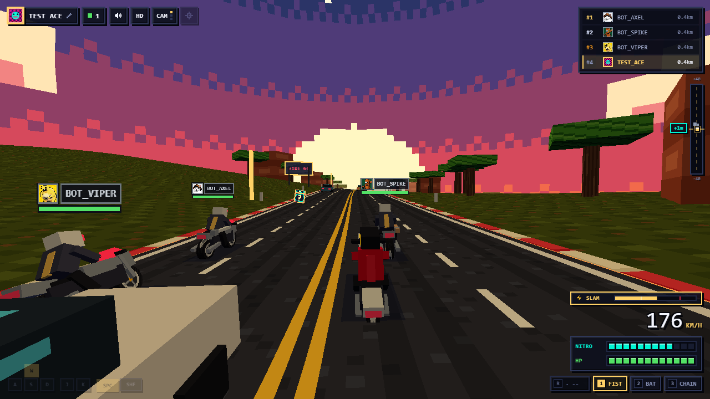

# VIBE MOTO

[English](#english) | [简体中文](#简体中文)

**Play Online / 在线试玩:** **https://bestk.github.io/vibe-moto/**
Private Room / 自定义房间: `https://bestk.github.io/vibe-moto/?room=<name>`

---

## English

HD-pixel 3D multiplayer Road Rash on a seamless 2400m cyclic highway, built with Three.js and a zero-dependency native WebSocket MQTT 3.1.1 client.

### Screenshots



| 2400m Cyclic Circuit & `START ★ LAP` Arch | Multi-Item 30s Tray & AI Bot Sniper Lock |
| :---: | :---: |
|  |  |
| **Sniper Scope, Mystery Crates & Live Broadcasts** | **Wheelie Charge-Slam & 3D Avatar Nameplates** |
|  |  |
| **Dual-Client EMQX 5m Pack Spawn & Custom Avatar Sync** | **Retro PX Mode Nitro & Melee Combat** |
|  |  |

### Features

- **Seamless 2400m Cyclic Looping Highway** — Continuous C∞ looping track spanning 4 biomes (`600m` each) with a checkered 3D `START ★ LAP` overhead arch and `L1/L2` lap standings. Visibility, radar, melee combat, and powerups work seamlessly across laps so 1st place literally catches up to and laps trailing riders.
- **8 Pickable Powerups, Multi-Item Stack & AI Bot Items** — Smash `?` mystery crates to hold up to **4 items** at once (1 item stays indefinitely; holding `≥2` activates an independent **30s TTL countdown** per slot—use with `R`/`X` or click any slot directly). AI `[BOT]` rivals also grab crates and fire all 8 items, including real sniper locks with dodge alerts:
  - 🚀 **RPG** — Forward homing rocket blast that launches rivals and traffic
  - ✈️ **Airstrike** — Bomber flyover dropping chained explosions ahead
  - 🎯 **Sniper** — Target picker (`1–5`), 3D laser crosshair lock, and fair dodge window (`Space`)
  - 🚓 **Police Pull** — Summons a squad car to intercept the pack leader
  - ⚡ **Turbo Shield** — High-speed surge with temporary impact invulnerability
  - ⚙️ **Spike Trap** — Drops road spikes behind your bike
  - 🧲 **Magnet** — Pulls nearby crates and disrupts nearby riders
  - 🍌 **Banana Peel** — Rear hazard that spins out chasing rivals
- **Wheelie Boost, Charge-Slam & Backflip Risk** — Hold `Space` to pop a wheelie for extra speed and charge the gold `⚡ SLAM` bar; release to slam nearby rivals sideways, or hold past the red limit to backflip crash.
- **Mobile Gyroscope Tilt Steering & Tap-Screen-to-Attack** — Toggle `🧭` gyroscope steering with automatic portrait/landscape calibration on iOS & Android, and tap the **left / right / center** of the canvas directly to throw left, right, or auto-targeted strikes.
- **9 Pure-Code Pixel Avatars + Custom Avatar Sync** — Click the top-left pill to rename or pick from 9 procedural 32×32 pixel avatars, or upload any image—automatically center-cropped & compressed on the frontend to WebP/JPEG (`<3.2 KB`) and synced as base64 over EMQX to all players' standings & 3D nameplates.
- **Zero-Config EMQX Multiplayer & High Performance** — Connects to `wss://broker.emqx.io:8084/mqtt`, auto-spawns new riders **5m behind the last active player**, supports one-click regroup (`⌖`) and fast tab-close cleanup. Sole runtime dependency is `three`, with zero-dep native WebSocket MQTT 3.1.1 binary sync, instanced traffic/scenery/crates, progressive road LOD, zero-idle background pause, steady **60 FPS**, and **~10 MB JS heap**.

### Controls

| Input | Action |
| :--- | :--- |
| `W` `A` `S` `D` / `Arrow Keys` | Throttle / Steer / Brake |
| `Shift` | Nitro Boost |
| `Space` (hold & release) | Wheelie Speed Boost / Charge-Slam (over-hold = backflip crash) |
| `R` / `X` / Click Item Slot | Use Active (or Clicked) Powerup |
| `1`–`5` / `Esc` *(Sniper active)* | Lock Sniper Target / Cancel Aim |
| `J` / `Q` / `Left-Click` | Attack Left |
| `K` / `E` / `Right-Click` | Attack Right |
| `L` / `F` | Auto-Strike Nearest Rival |
| `1` `2` `3` / `Tab` | Switch Weapon (`Fist` / `Bat` / `Chain`) |
| `C` | Cycle Camera (`CHASE` / `LOW` / `HOOD`) |
| `P` | Toggle `HD` / `PX` Pixel Mode |
| `M` | Toggle Audio Mute |
| `🧭` Gyroscope *(Mobile)* | Analog Tilt Steering (auto-calibrates portrait & landscape) |
| `Tap Canvas` *(Mobile)* | Tap Left / Right / Center of Screen to Strike |

### Multiplayer Rooms

Share a URL with `?room=<name>` to race in an isolated room:

```text
https://bestk.github.io/vibe-moto/?room=friday-night
```

### Quick Start

```bash
pnpm install
pnpm dev
pnpm build
```

---

## 简体中文

基于 Three.js 与零依赖原生 WebSocket MQTT 3.1.1 打造的 2400 米轮回赛道 3D 高清像素多人《暴力摩托》。

### 在线试玩

- 公共大厅：**https://bestk.github.io/vibe-moto/**
- 自定义联机房间：`https://bestk.github.io/vibe-moto/?room=<房间名>`

### 游戏特性

- **2400 米无缝轮回赛道（跨圈套圈对抗）** — 4 段 600 米地貌无缝衔接成 C∞ 循环公路，配有 3D 格子旗 `START ★ LAP` 起点拱门与 `L1/L2` 圈数排名；视野、雷达、近战与道具全面支持跨圈交互，第一名可真正追上并套圈击打落后车手。
- **8 种公路道具 · 最多 4 格堆叠（30s 倒计时）· AI 道具对抗** — 撞击 `?` 神秘箱最多可同时持有 **4 个道具**（单道具永久保留；持有 `≥2` 个时各槽位独立开启 **30 秒倒计时**，按 `R`/`X` 或直接点击槽位释放）。AI `[BOT]` 对手同样会抢箱并真实使用全部 8 种道具（含狙击锁敌与闪避警报）：
  - 🚀 **RPG 火箭筒** — 发射前向追踪火箭弹轰飞对手与车流
  - ✈️ **空中支援** — 召唤轰炸机沿前方公路连续地毯式轰炸
  - 🎯 **狙击枪** — `1–5` 选人锁定、3D 激光瞄准镜与 `Space` 公平闪避窗口
  - 🚓 **警车拦截** — 呼叫警车精准拦截领先车手
  - ⚡ **超级加速** — 爆发极限速度并附带短暂碰撞护盾
  - ⚙️ **路钉陷阱** — 在身后布设路钉逼停追兵
  - 🧲 **磁铁** — 吸附附近道具并干扰周边车手
  - 🍌 **香蕉皮** — 向后丢出滑倒陷阱令追击者打滑失控
- **翘头提速 · 蓄力猛压 · 翻车风险** — 按住 `Space` 翘头获得额外提速并蓄力金色 `⚡ SLAM` 能量条，松手猛压震飞身旁对手；蓄力超时则会翘头过度后空翻翻车。
- **移动端陀螺仪重力转向 + 轻触屏幕攻击** — 支持点击 `🧭` 开启重力感应线性转向（自动适配 iOS / Android 横竖屏校准），并可直接点击画面**左 / 右 / 中央**触发左击、右击或自动挥击。
- **9 款纯代码像素头像 + 自定义头像压缩同步** — 点击左上角名牌即可改名并切换 9 款 32×32 纯代码像素头像，也可上传自定义图片——前端自动居中裁切压缩为 `<3.2 KB` WebP/JPEG base64，经 EMQX 实时同步到全员排行榜与 3D 车手名牌。
- **免配置 EMQX 实时联机与极致性能** — 直连 `wss://broker.emqx.io:8084/mqtt`，加入后自动空降到最后一名在线玩家后方 **5 米**，支持一键归队（`⌖`）与关页秒级退房清理。唯一运行时依赖为 `three`，自研零依赖原生 WebSocket MQTT 3.1.1 二进制同步、全实例化车流/场景/道具箱、渐进式公路 LOD、后台零消耗休眠，稳跑 **60 FPS**、仅占约 **10 MB JS 堆内存**。

### 操作按键

| 按键 / 操作 | 功能 |
| :--- | :--- |
| `W` `A` `S` `D` / 方向键 | 加速 / 转向 / 刹车 |
| `Shift` | 氮气加速 |
| `Space`（按住 / 松开） | 翘头提速 / 蓄力猛压攻击（超时后空翻翻车） |
| `R` / `X` / 点击道具槽 | 使用当前（或指定）道具 |
| `1`–`5` / `Esc`（狙击选人时） | 锁定目标 / 取消狙击 |
| `J` / `Q` / 鼠标左键 | 向左攻击 |
| `K` / `E` / 鼠标右键 | 向右攻击 |
| `L` / `F` | 自动攻击最近对手 |
| `1` `2` `3` / `Tab` | 切换武器（拳 / 棒 / 链） |
| `C` | 切换视角（`CHASE` / `LOW` / `HOOD`） |
| `P` | 切换 `HD` / `PX` 像素模式 |
| `M` | 静音开关 |
| `🧭` 陀螺仪（移动端） | 重力倾斜线性转向（横竖屏自动校准） |
| 轻触画面（移动端） | 点击左 / 右 / 中央直接向对应方向攻击 |

### 自定义联机房间

在网址后追加 `?room=<房间名>` 即可与好友进入同一独立房间：

```text
https://bestk.github.io/vibe-moto/?room=friday-night
```

### 本地开发

```bash
pnpm install
pnpm dev
pnpm build
```
