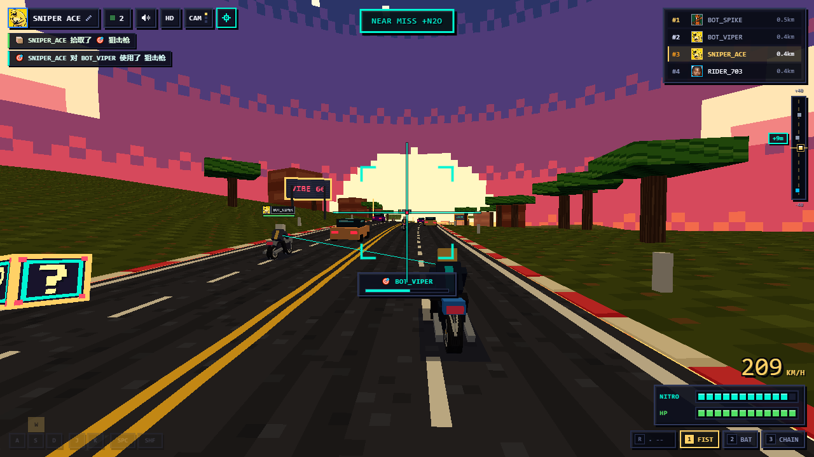
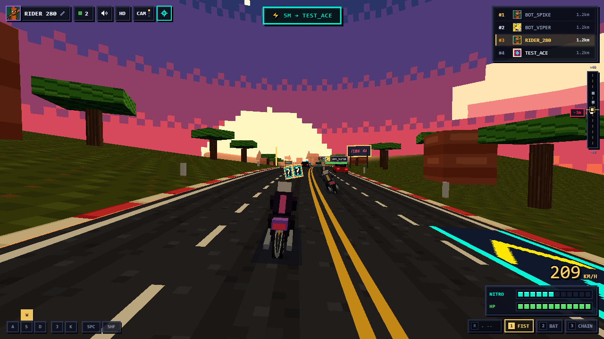
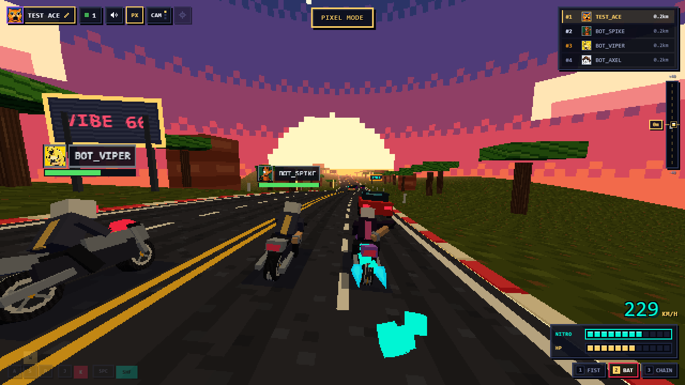

# VIBE MOTO

[English](#english) | [简体中文](#简体中文)

**Play Online / 在线试玩:** **https://bestk.github.io/vibe-moto/**
Private Room / 自定义房间: `https://bestk.github.io/vibe-moto/?room=<name>`

---

## English

HD-pixel 3D multiplayer Road Rash built with Three.js and a zero-dependency native WebSocket MQTT 3.1.1 client.

### Screenshots


| Sniper Scope, Mystery Crates & Live Broadcasts | Wheelie Charge-Slam & 3D Avatar Nameplates |
| :---: | :---: |
|  |  |
| **Dual-Client EMQX 5m Pack Spawn & Custom Avatar Sync** | **Retro PX Mode Nitro & Melee Combat** |
|  |  |

### Features

- **8 Pickable Highway Powerups + Live Room Broadcasts** — Smash floating `?` mystery crates to grab items and broadcast pickups, uses, and hits to everyone in the room:
  - 🚀 **RPG** — Forward rocket blast that launches rivals and traffic
  - ✈️ **Airstrike** — Bomber flyover dropping chained explosions ahead
  - 🎯 **Sniper** — Target picker (`1–5`), 3D laser crosshair lock, and fair dodge window for the targeted rider
  - 🚓 **Police Pull** — Summons a squad car to intercept the pack leader
  - ⚡ **Turbo Shield** — High-speed surge with temporary impact invulnerability
  - ⚙️ **Spike Trap** — Drops road spikes behind your bike
  - 🧲 **Magnet** — Pulls nearby crates and disrupts nearby riders
  - 🍌 **Banana Peel** — Rear hazard that spins out chasing rivals
- **Wheelie Boost, Charge-Slam & Backflip Risk** — Hold `Space` to pop a wheelie for extra top speed and charge the gold `⚡ SLAM` bar; release to slam nearby rivals sideways, or hold past the red limit to backflip crash.
- **Road Rash Melee Combat & Procedural Web Audio** — Fight side-by-side with **Fist**, **Bat**, and **Chain**, boost with nitro, and hear real-time synthesized 5-gear engine & impact SFX with zero external audio files.
- **9 Pure-Code Pixel Avatars + Custom Avatar Sync** — Click the top-left pill to rename or pick from 9 procedural 32×32 pixel avatars, or upload any custom image — automatically center-cropped & compressed on the frontend to WebP/JPEG (`<3.2 KB`) and synced as base64 over EMQX to all players' standings & 3D nameplates.
- **Zero-Config EMQX Multiplayer & 5m Pack Spawn** — Connects directly to public `wss://broker.emqx.io:8084/mqtt`, automatically spawns new riders **5m behind the last active player**, supports one-click regroup (`⌖`), fast tab-close cleanup, and rubber-banding `[BOT]` rivals when riding solo.
- **High-Performance Architecture** — Sole runtime dependency is `three`; custom zero-dep native WebSocket MQTT 3.1.1 binary sync (`~35%` smaller bundle), instanced traffic / scenery / crates, progressive road LOD, zero-idle background pause, steady **60 FPS**, and **~10 MB JS heap**.

### Controls

| Input | Action |
| :--- | :--- |
| `W` `A` `S` `D` / `Arrow Keys` | Throttle / Steer / Brake |
| `Shift` | Nitro Boost |
| `Space` (hold & release) | Wheelie Speed Boost / Charge-Slam (over-hold = backflip crash) |
| `R` / `X` | Use Held Powerup |
| `1`–`5` / `Esc` *(Sniper active)* | Lock Sniper Target / Cancel Aim |
| `J` / `Q` / `Left-Click` | Attack Left |
| `K` / `E` / `Right-Click` | Attack Right |
| `L` / `F` | Auto-Strike Nearest Rival |
| `1` `2` `3` / `Tab` | Switch Weapon (`Fist` / `Bat` / `Chain`) |
| `C` | Cycle Camera (`CHASE` / `LOW` / `HOOD`) |
| `P` | Toggle `HD` / `PX` Pixel Mode |
| `M` | Toggle Audio Mute |
| `Touch Controls` | Auto-enabled on touch devices (steer, brake, nitro, wheelie, item, strike) |

### Multiplayer Rooms

Share a URL with `?room=<name>` to race in an isolated room:

```text
https://bestk.github.io/vibe-moto/?room=friday-night
```

### Quick Start

```bash
pnpm install
pnpm dev
pnpm build
```

---

## 简体中文

基于 Three.js 与零依赖原生 WebSocket MQTT 3.1.1 协议打造的 3D 高清像素多人《暴力摩托》。

### 在线试玩

- 公共大厅：**https://bestk.github.io/vibe-moto/**
- 自定义联机房间：`https://bestk.github.io/vibe-moto/?room=<房间名>`

### 游戏特性

- **8 种公路拾取道具 + 全场实时播报** — 撞击赛道上的 `?` 神秘箱即可拾取道具，拾取、使用与命中事件实时播报给房间内所有玩家：
  - 🚀 **RPG 火箭筒** — 向前发射高爆火箭弹轰飞对手与车流
  - ✈️ **空中支援** — 召唤轰炸机沿公路前方连续地毯式轰炸
  - 🎯 **狙击枪** — 支持 `1–5` 选人锁定、3D 激光瞄准镜与目标公平闪避判定
  - 🚓 **警车拦截** — 呼叫警车精准拦截前方领先车手
  - ⚡ **超级加速** — 爆发极限速度并附带短暂碰撞护盾
  - ⚙️ **路钉陷阱** — 在身后布设路钉逼停追兵
  - 🧲 **磁铁** — 吸附附近道具并干扰周边车手
  - 🍌 **香蕉皮** — 向后丢出滑倒陷阱令追击者打滑失控
- **翘头提速 · 蓄力猛压 · 翻车风险** — 按住 `Space` 翘头获得额外提速并蓄力金色 `⚡ SLAM` 能量条，松手猛压震飞身旁对手；蓄力超时进入危险区则会翘头过度后空翻翻车。
- **经典暴力摩托近战与纯合成音效** — 支持**拳击（FIST）**、**球棒（BAT）**、**铁链（CHAIN）**左右挥击与氮气喷射；纯 Web Audio API 实时合成 5 挡引擎与打击音效，零外部音频资源。
- **9 款纯代码像素头像 + 自定义头像压缩同步** — 点击左上角名牌即可改名并切换 9 款 32×32 纯代码像素头像，也可上传自定义图片——前端自动居中裁切并压缩为 `<3.2 KB` 的 WebP/JPEG base64，经 EMQX 实时同步到所有玩家的排行榜与 3D 车手名牌。
- **免配置 EMQX 实时联机与 5 米空降归队** — 直连公共 `wss://broker.emqx.io:8084/mqtt`，加入后**自动空降到最后一名在线玩家后方 5 米**，支持一键归队（`⌖`）、关闭标签页秒级退房清理，以及单人自动补位 AI 对手。
- **极致性能架构** — 唯一运行时依赖为 `three`；自研零依赖原生 WebSocket MQTT 3.1.1 二进制同步（打包体积缩减约 `35%`），全实例化车流/场景/道具箱、渐进式公路 LOD、后台标签页零消耗休眠，稳跑 **60 FPS**、仅占约 **10 MB JS 堆内存**。

### 操作按键

| 按键 / 操作 | 功能 |
| :--- | :--- |
| `W` `A` `S` `D` / 方向键 | 加速 / 转向 / 刹车 |
| `Shift` | 氮气加速 |
| `Space`（按住 / 松开） | 翘头提速 / 蓄力猛压攻击（超时后空翻翻车） |
| `R` / `X` | 使用已拾取道具 |
| `1`–`5` / `Esc`（狙击选人时） | 锁定目标 / 取消狙击 |
| `J` / `Q` / 鼠标左键 | 向左攻击 |
| `K` / `E` / 鼠标右键 | 向右攻击 |
| `L` / `F` | 自动攻击最近对手 |
| `1` `2` `3` / `Tab` | 切换武器（拳 / 棒 / 链） |
| `C` | 切换视角（`CHASE` / `LOW` / `HOOD`） |
| `P` | 切换 `HD` / `PX` 像素模式 |
| `M` | 静音开关 |
| 触屏虚拟按键 | 移动设备自动开启（转向、刹车、氮气、翘头、道具、左右攻击） |

### 自定义联机房间

在网址后追加 `?room=<房间名>` 即可与好友进入同一独立房间：

```text
https://bestk.github.io/vibe-moto/?room=friday-night
```

### 本地开发

```bash
pnpm install
pnpm dev
pnpm build
```
