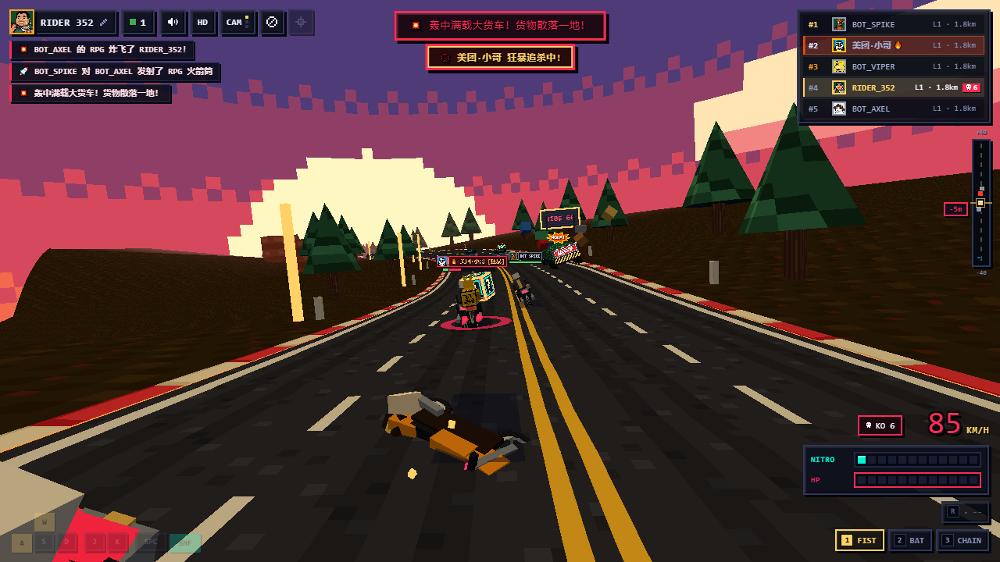
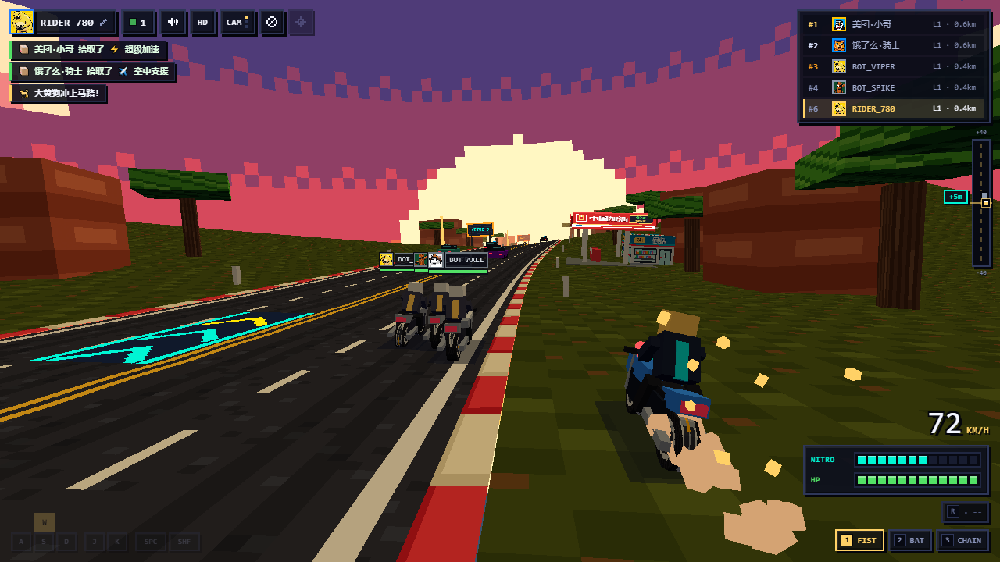
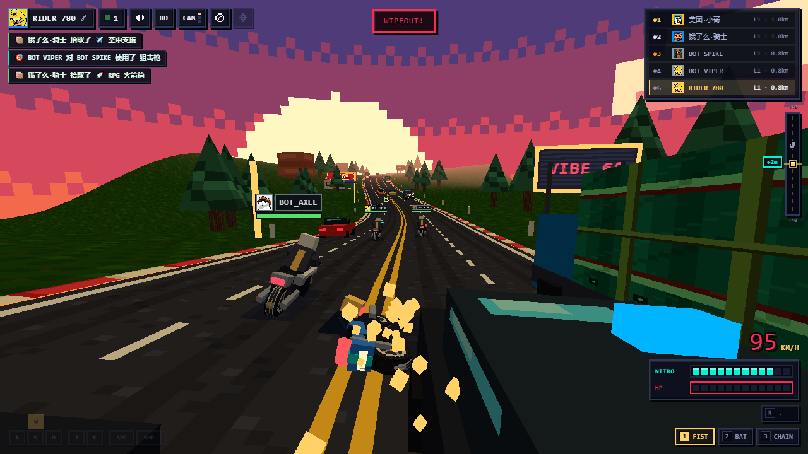
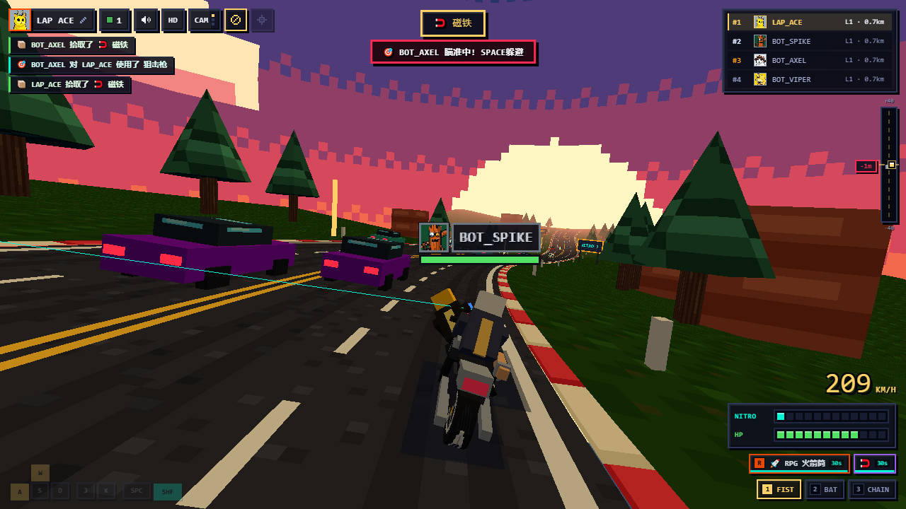
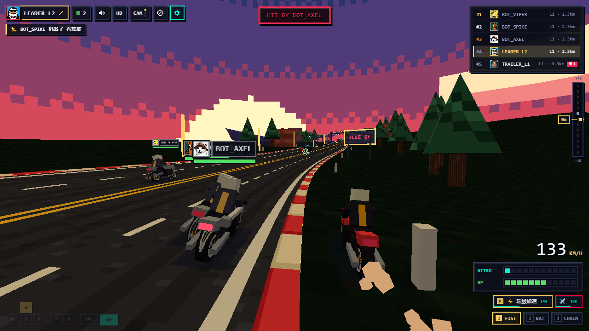

# VIBE MOTO

[English](#english) | [简体中文](#简体中文)

**Play Online / 在线试玩:** **https://bestk.github.io/vibe-moto/**
Private Room / 自定义房间: `https://bestk.github.io/vibe-moto/?room=<name>`

---

## English

HD-pixel 3D multiplayer Road Rash on a 2400m cyclic Chinese national highway, built with Three.js and a zero-dependency native WebSocket MQTT 3.1.1 client.

### Screenshots



| Chinese Gas Station (`中国加油`) & Delivery Riders | Overloaded Tarp Freight Truck & `国道饭店` Diner |
| :---: | :---: |
|  |  |
| **Instant-Play Highway & 9 Pixel Avatars** | **Multi-Item 30s Tray & Bot Sniper Lock** |
|  |  |
| **2400m Cyclic Circuit & `START ★ LAP` Arch** | **EMQX 5m Pack Spawn & Custom Avatar Sync** |
|  |  |

### Features

- **Chinese National Highway Landmarks** — Cruise past procedural pixel-art **Chinese Gas Stations** (`中国加油 92# 95#` canopy + `24H 便利店`, right-shoulder drive-by grants `+25% N2O` refill) and **National Highway Diners** (`国道饭店 · 司机之家` with ceramic tiles and glowing red lanterns).
- **Meituan & Ele.me Delivery Riders + Enraged Revenge** — Race alongside `美团·小哥` (kangaroo-ear helmet & yellow box) and `饿了么·骑士` (winged helmet & blue box). Strike them at your own risk: attacking a delivery rider triggers **18s Enraged Revenge Mode** (`🔥 狂暴追杀中!`), boosting them into a relentless **250 km/h** chase with crimson aura and live room broadcasts.
- **Road-Crossing Animals & Herds** — Watch for early alerts as solo animals (village dog, wild boar, goose) and herds (sheep flock, cow herd) dart across the highway; swerve around them or pop a `Space` wheelie-hop to leap cleanly over.
- **Overloaded Chinese Freight Trucks (Reactive to All Items)** — Dodge massive outer-lane cargo trucks (`保持车距` hazard bumper, tarp / timber / watermelon loads) that react dynamically to every powerup: **RPG / Airstrike** blasts scatter dodgeable tumbling cargo crates onto the asphalt, **Banana Peels** cause fishtail spins, **Spike Traps / Sniper** trigger tire blowouts, and **Police / Magnet** pull & disrupt them.
- **Seamless 2400m Cyclic Looping Highway** — Continuous C∞ loop spanning 4 biomes (`600m` each) with a checkered 3D `START ★ LAP` arch and `L1/L2` standings. Sight, radar, melee combat, and items work across laps so 1st place catches and laps trailing players.
- **8 Pickable Powerups, 4-Slot 30s Stack & AI Bot Items** — Smash `?` crates to hold up to **4 items** (1 item stays indefinitely; `≥2` items run independent **30s TTL countdowns**—use via `R`/`X` or click any slot). Bots also pick up and fire all 8 items:
  - 🚀 **RPG** · ✈️ **Airstrike** · 🎯 **Sniper** (`1–5` lock, 3D laser, `Space` dodge) · 🚓 **Police Pull** · ⚡ **Turbo Shield** · ⚙️ **Spike Trap** · 🧲 **Magnet** · 🍌 **Banana Peel**
- **Wheelie Boost, Charge-Slam & Backflip Risk** — Hold `Space` for wheelie speed and gold `⚡ SLAM` charge; release to slam rivals sideways, or over-hold into a backflip crash.
- **Mobile Gyroscope Tilt Steering & Tap-Screen-to-Attack** — Toggle `🧭` gyroscope steering with portrait/landscape auto-calibration on iOS & Android, and tap the **left / right / center** of the canvas to strike.
- **9 Pure-Code Pixel Avatars + Custom Base64 Sync** — Rename inline, pick from 9 procedural 32×32 pixel avatars, or upload any custom image—center-cropped & compressed on the frontend to WebP/JPEG (`<3.2 KB`) and synced over EMQX to standings & 3D nameplates.
- **Studio Hybrid Audio (`vibe-motion/sound`)** — Pairs **18 CC0 studio SFX** (`152 KB` total, lazy-loaded via [`vibe-motion/sound`](https://github.com/vibe-motion/sound)) with a triple-oscillator boxer motorcycle engine synth, `DynamicsCompressorNode` master bus, stereo Doppler sweeps, and seamless procedural fallback.
- **Zero-Config EMQX Multiplayer & High Performance** — Connects to `wss://broker.emqx.io:8084/mqtt` with **5m behind-last-player spawn**, one-click regroup (`⌖`), and fast tab-close cleanup. Sole runtime dependency is `three`, featuring a zero-dep native WebSocket MQTT 3.1.1 client, instanced traffic/scenery/animals/crates, progressive road LOD, steady **60 FPS**, and **~13 MB JS heap**.

### Controls

| Input | Action |
| :--- | :--- |
| `W` `A` `S` `D` / `Arrow Keys` | Throttle / Steer / Brake |
| `Shift` | Nitro Boost |
| `Space` (hold & release) | Wheelie Speed Boost / Charge-Slam / Hop Animals (over-hold = flip crash) |
| `R` / `X` / Click Item Slot | Use Active (or Clicked) Powerup |
| `1`–`5` / `Esc` *(Sniper active)* | Lock Sniper Target / Cancel Aim |
| `J` / `Q` / `Left-Click` | Attack Left |
| `K` / `E` / `Right-Click` | Attack Right |
| `L` / `F` | Auto-Strike Nearest Rival |
| `1` `2` `3` / `Tab` | Switch Weapon (`Fist` / `Bat` / `Chain`) |
| `C` | Cycle Camera (`CHASE` / `LOW` / `HOOD`) |
| `P` | Toggle `HD` / `PX` Pixel Mode |
| `M` | Toggle Audio Mute |
| `🧭` Gyroscope *(Mobile)* | Analog Tilt Steering (portrait & landscape auto-calibration) |
| `Tap Canvas` *(Mobile)* | Tap Left / Right / Center of Screen to Strike |

### Multiplayer Rooms

Share a URL with `?room=<name>` to race in an isolated room:

```text
https://bestk.github.io/vibe-moto/?room=friday-night
```

### Quick Start

```bash
pnpm install
pnpm dev
pnpm build
```

---

## 简体中文

基于 Three.js 与零依赖原生 WebSocket MQTT 3.1.1 打造的 2400 米中国国道轮回赛道 3D 高清像素多人《暴力摩托》。

### 在线试玩

- 公共大厅：**https://bestk.github.io/vibe-moto/**
- 自定义联机房间：`https://bestk.github.io/vibe-moto/?room=<房间名>`

### 游戏特性

- **中国国道特色地标** — 赛道沿途配有纯程序化像素风**中国加油站**（`中国加油 92# 95#` 红色顶棚与 `24H 便利店`，贴近右侧路肩经过自动补给 `+25%` 氮气）与**国道饭店**（`国道饭店 · 司机之家` 瓷砖立面与发光红灯笼）。
- **美团 / 饿了么外卖骑手 + 狂暴复仇机制** — 同场驰骋的 `美团·小哥`（袋鼠耳头盔 + 黄色餐箱）与 `饿了么·骑士`（小蓝翼头盔 + 蓝色餐箱）；一旦惹毛并攻击他们，将触发 **18 秒狂暴追杀模式**（`🔥 狂暴追杀中!`），脚底泛起血红光环并以 **250 km/h** 极限狂追复仇！
- **国道横穿动物与畜群** — 公路随机触发独行动物（大黄狗、野猪、大白鹅）与成群畜群（羊群、牛群）横穿预警，可提前变道闪避或按 `Space` 翘头起跳凌空飞跃。
- **满载中国大货车（全道具物理交互）** — 外侧车道行驶贴有 `保持车距` 警示条的篷布 / 原木 / 西瓜满载大货车，对全部 8 种道具均有专属反馈：**RPG / 空袭**轰中会剧烈倾斜并震落满地可躲避翻滚货箱，**香蕉皮**引发甩尾打滑，**路钉 / 狙击**触发爆胎急停，**警车 / 磁铁**亦有联动干扰效果。
- **2400 米无缝轮回赛道（跨圈套圈对抗）** — 4 段 600 米地貌无缝循环，配有 3D 格子旗 `START ★ LAP` 拱门与 `L1/L2` 圈数排名；视野、雷达、近战与道具全面支持跨圈交互，第一名可真正追上并套圈击打落后车手。
- **8 种公路道具 · 4 格 30s 堆叠 · AI 道具对抗** — 撞击 `?` 神秘箱最多同时持有 **4 个道具**（单道具永久保留；持有 `≥2` 个时各槽位独立开启 **30 秒倒计时**，按 `R`/`X` 或直接点击槽位释放）。AI 对手同样会抢箱并真实使用全部 8 种道具：
  - 🚀 **RPG 火箭筒** · ✈️ **空中支援** · 🎯 **狙击枪**（`1–5` 锁人 / 3D 激光 / `Space` 闪避）· 🚓 **警车拦截** · ⚡ **超级加速** · ⚙️ **路钉陷阱** · 🧲 **磁铁** · 🍌 **香蕉皮**
- **翘头提速 · 蓄力猛压 · 翻车风险** — 按住 `Space` 翘头提速并蓄力金色 `⚡ SLAM` 能量条，松手震飞身旁对手；蓄力超时将后空翻翻车。
- **移动端陀螺仪重力转向 + 轻触屏幕攻击** — 点击 `🧭` 开启重力感应线性转向（自动适配 iOS / Android 横竖屏校准），轻触画面**左 / 右 / 中央**直接向对应方向攻击。
- **9 款纯代码像素头像 + 自定义头像压缩同步** — 点击左上角名牌快捷改名并切换 9 款 32×32 纯代码像素头像，也可上传自定义图片——前端自动居中裁切压缩为 `<3.2 KB` WebP/JPEG base64，经 EMQX 实时同步到全员排行榜与 3D 车手名牌。
- **工作室级混合音频引擎（`vibe-motion/sound`）** — 内置经 [`vibe-motion/sound`](https://github.com/vibe-motion/sound) 精选压制的 **18 条 CC0 工作室级音效**（总计仅 `152 KB`，首交互懒加载），搭配三振荡器水平对置摩托引擎合成器、`DynamicsCompressorNode` 母线动态压缩、立体声多普勒扫频与零延迟程序化回退。
- **免配置 EMQX 实时联机与极致性能** — 直连 `wss://broker.emqx.io:8084/mqtt`，自动空降到最后一名在线玩家后方 **5 米**，支持一键归队（`⌖`）与关页秒级退房清理。唯一运行时依赖为 `three`，自研零依赖原生 WebSocket MQTT 3.1.1 客户端、全实例化车流/动物/场景/货箱、渐进式公路 LOD，稳跑 **60 FPS**、仅占约 **13 MB JS 堆内存**。

### 操作按键

| 按键 / 操作 | 功能 |
| :--- | :--- |
| `W` `A` `S` `D` / 方向键 | 加速 / 转向 / 刹车 |
| `Shift` | 氮气加速 |
| `Space`（按住 / 松开） | 翘头提速 / 蓄力猛压 / 跳过动物（超时后空翻翻车） |
| `R` / `X` / 点击道具槽 | 使用当前（或指定）道具 |
| `1`–`5` / `Esc`（狙击选人时） | 锁定目标 / 取消狙击 |
| `J` / `Q` / 鼠标左键 | 向左攻击 |
| `K` / `E` / 鼠标右键 | 向右攻击 |
| `L` / `F` | 自动攻击最近对手 |
| `1` `2` `3` / `Tab` | 切换武器（拳 / 棒 / 链） |
| `C` | 切换视角（`CHASE` / `LOW` / `HOOD`） |
| `P` | 切换 `HD` / `PX` 像素模式 |
| `M` | 静音开关 |
| `🧭` 陀螺仪（移动端） | 重力倾斜线性转向（横竖屏自动校准） |
| 轻触画面（移动端） | 点击左 / 右 / 中央直接向对应方向攻击 |

### 自定义联机房间

在网址后追加 `?room=<房间名>` 即可与好友进入同一独立房间：

```text
https://bestk.github.io/vibe-moto/?room=friday-night
```

### 本地开发

```bash
pnpm install
pnpm dev
pnpm build
```
